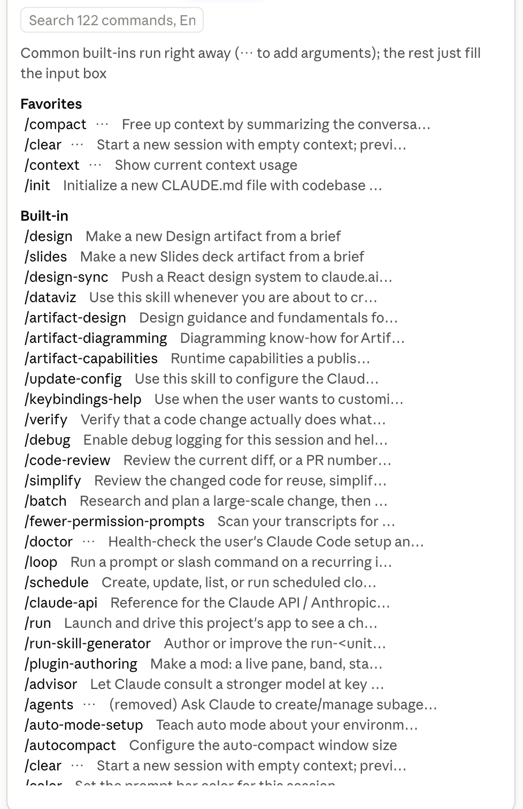
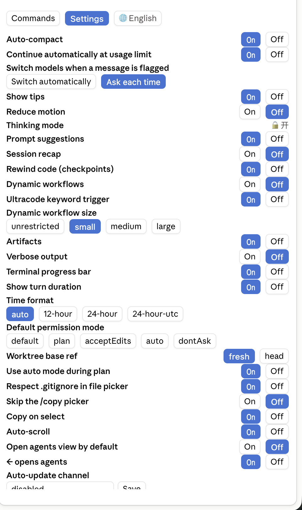

# jack-mods

[简体中文](README.md) · [English](README.en.md) · [Русский](README.ru.md) · **فارسی**

مادهای شخصی من برای Claude Code.

هر دو کنار نام مدل، زیر کادر ورودی قرار دارند: ⚡ quick-commands، 🪙 token-band (در حالت جمع‌شده).


## token-band

نواری بالای کادر ورودی که مصرف توکن را به‌صورت زنده نشان می‌دهد:


با زدن دکمهٔ جمع‌کردن، کل نوار پنهان می‌شود و فقط یک 🪙 در سمت راست نوار ابزار زیر کادر ورودی می‌ماند. برای باز کردن دوباره روی آن بزنید:


```
271.1k/1.00M (27%) · this turn 3.3k · 113 tok/s · total in 7.92M · total out 38.4k · cache 98% · $8.58 · 5h 99% · 7d 70% ✅   [collapse]
```

> برچسب‌های نوار در تصاویر فعلاً چینی هستند؛ خط بالا همان فیلدها را به انگلیسی و با همان ترتیب نشان می‌دهد.

| مورد | معنی |
|---|---|
| `271.1k/1.00M (27%)` | اندازهٔ فعلی کانتکست / پنجرهٔ مدل |
| this turn | توکن‌های خروجی این نوبت؛ در حین آمدن پاسخ بالا می‌رود |
| `tok/s` | میانگین سرعت خروجی: کل خروجی ÷ کل زمان تولید (از اولین تا آخرین توکن، بدون زمان انتظار برای اولین توکن) |
| total in / total out | مجموع کل جلسه، شامل خواندن و نوشتن کش و زیرعامل‌ها |
| cache | سهم ورودی‌ای که از کش آمده؛ هرچه بیشتر، ارزان‌تر |
| `$` | هزینهٔ جلسه |
| `5h` / `7d` | درصد مصرف‌شده از سقف ۵ ساعته / ۷ روزهٔ اشتراک (در پرداخت از طریق API نمایش داده نمی‌شود) |
| `✅` / `❌` | بررسی مدل: اگر گفت‌وگوی اصلی به مدل دیگری تغییر کند، API مدلی غیر از مدل درخواستی برگرداند، یا سطح استدلال بی‌صدا پایین آورده شود، ❌ می‌شود و اعلانی با دلیل نشان می‌دهد |

- در پنجره‌های باریک، نوار به دو خط شکسته می‌شود و دکمهٔ جمع‌کردن در سمت راست خط اول می‌ماند.
- با تایپ `/tokens` هم می‌توانید بین حالت باز و جمع‌شده جابه‌جا شوید.

## quick-commands

یک دکمهٔ ⚡ سمت راست نام مدل اضافه می‌کند. این دکمه یک پنل کناری باز می‌کند تا لازم نباشد `/xxx` را دستی تایپ کنید:

- **زبانهٔ «فرمان‌ها»**: همهٔ فرمان‌های اسلش جلسهٔ فعلی (داخلی، فرمان‌های خودتان، افزونه‌ها و مهارت‌ها، MCP)، دسته‌بندی‌شده و قابل جست‌وجو.
  - فرمان‌های داخلی پرکاربرد (`/compact`، `/clear`، `/context`، `/cost`، `/resume` و …) با یک کلیک اجرا می‌شوند.
  - بقیه (مهارت‌ها، فرمان‌های افزونه و MCP) فقط `/name ` را در کادر ورودی می‌گذارند تا آرگومان‌ها را بنویسید و خودتان بفرستید. چیزی ناخواسته اجرا نمی‌شود.
  - دکمهٔ `⋯` کنار فرمان‌های داخلی برای وارد کردن آرگومان است؛ اگر خروجی فرمانی «Available: a, b, c» را فهرست کند، ماد آن را به خاطر می‌سپارد و دفعهٔ بعد گزینه‌ها را به‌صورت دکمه نشان می‌دهد.
- **زبانهٔ «تنظیمات»**: تنظیمات `/config` به‌صورت دکمه. کلیدها «روشن / خاموش»، تنظیمات چندگزینه‌ای یک دکمه برای هر گزینه، و متن و عدد یک کادر ورودی دارند. مقدار فعلی پس‌زمینهٔ آبی دارد.
- **چینی / انگلیسی**: رابط به‌طور پیش‌فرض از `language` در `settings.json` یا زبان سیستم پیروی می‌کند؛ دکمهٔ 🌐 به‌صورت دستی بین «خودکار / چینی / انگلیسی» جابه‌جا می‌کند. رابط فارسی فعلاً وجود ندارد.
- برای باز کردن روی ⚡ بزنید؛ برای بستن دوباره بزنید (حالا ✕ است) یا Esc را فشار دهید.

دکمهٔ ⚡ سمت راست نام مدل:


پنل به انگلیسی (توضیحات و نام تنظیمات همان متن اصلی و بدون تغییر هستند):




## نصب

### پیش‌نیازها

- [Claude Code](https://code.claude.com) نصب باشد و فرمان `claude` در ترمینال کار کند. مادها هم در ترمینال و هم در برنامهٔ دسکتاپ کار می‌کنند.

### نصب هر دو (پیشنهادی)

در ترمینال بچسبانید:

```bash
claude plugin marketplace add crebot51/jack-mods && claude plugin install token-band@jack-mods && claude plugin install quick-commands@jack-mods
```

این فرمان بازارچهٔ `jack-mods` را اضافه می‌کند (فقط یک بار لازم است)، سپس هر دو ماد را برای کاربر شما نصب می‌کند تا در همهٔ پروژه‌ها در دسترس باشند.

### نصب فقط یکی

یک بار بازارچه را اضافه کنید، سپس هر کدام را که می‌خواهید نصب کنید:

```bash
claude plugin marketplace add crebot51/jack-mods
```

```bash
claude plugin install token-band@jack-mods
```

```bash
claude plugin install quick-commands@jack-mods
```

### بعد از نصب

1. یک جلسهٔ **جدید** باز کنید. جلسه‌ای که از قبل باز بوده، ماده‌هایی را که با آن شروع شده نگه می‌دارد؛ در آن `/reload-plugins` را اجرا کنید یا جلسهٔ جدیدی باز کنید.
2. بررسی کنید که همه چیز آمده باشد:
   - **token-band**: نوار مصرف بالای کادر ورودی. در برنامهٔ دسکتاپ بعد از اولین پیام ظاهر می‌شود.
   - **quick-commands**: یک ⚡ کنار نام مدل.

برای دیدن آنچه نصب شده:

```bash
claude plugin list
```

### به‌روزرسانی

بازارچه را تازه کنید، سپس هر ماد را به‌روز کنید:

```bash
claude plugin marketplace update jack-mods && claude plugin update token-band@jack-mods && claude plugin update quick-commands@jack-mods
```

سپس جلسهٔ جدیدی باز کنید یا در جلسهٔ باز `/reload-plugins` را اجرا کنید.

### حذف

یک ماد: `claude plugin uninstall <name>@jack-mods`

هر دو، همراه با بازارچه:

```bash
claude plugin uninstall token-band@jack-mods && claude plugin uninstall quick-commands@jack-mods && claude plugin marketplace remove jack-mods
```

### مشکلات رایج

| آنچه می‌بینید | چه کار کنید |
|---|---|
| بعد از نصب ⚡ / نوار دیده نمی‌شود | جلسه پیش از نصب باز بوده: `/reload-plugins` را اجرا کنید یا جلسهٔ جدیدی باز کنید. |
| token-band در برنامهٔ دسکتاپ چیزی نشان نمی‌دهد | یک پیام بفرستید؛ نوار بعد از اولین نوبت ظاهر می‌شود. |
| `claude plugin install` می‌گوید افزونه پیدا نشد | `claude plugin marketplace update jack-mods` را اجرا کنید و دوباره امتحان کنید. |

> API ماد فعلاً پیش‌نمایش اولیه است و ممکن است با تغییر نسخه‌های Claude Code به به‌روزرسانی نیاز داشته باشد.
