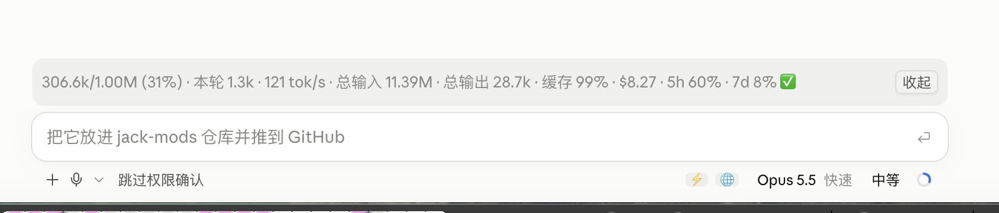
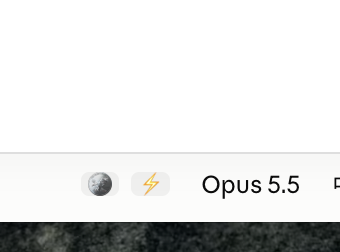
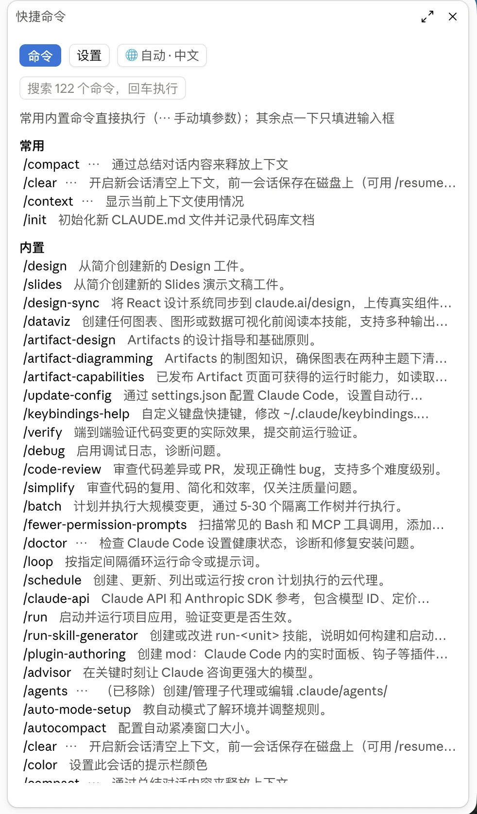
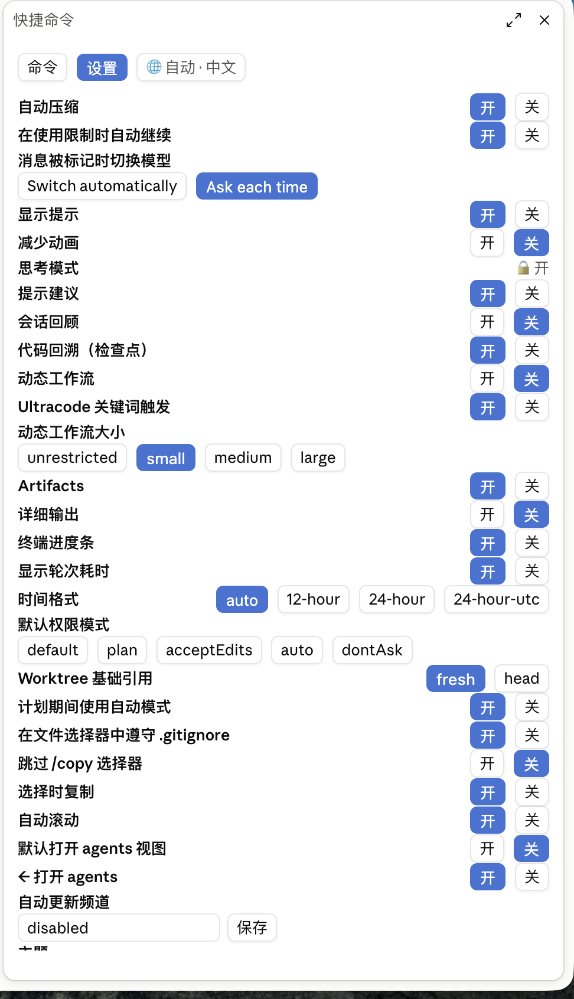

# jack-mods

**简体中文** · [English](README.en.md) · [Русский](README.ru.md) · [فارسی](README.fa.md)

自己写的 Claude Code mods。

两个 mod 的按钮都在输入框下方、模型名旁边：⚡ quick-commands、🪙 token-band（收起时）。


## token-band

在输入框上方实时显示 token 用量：



点「收起」后整栏消失，只在输入框下方工具栏右侧留一个 🪙，点它展开：


```
271.1k/1.00M (27%) · 本轮 3.3k · 113 tok/s · 总输入 7.92M · 总输出 38.4k · 缓存 98% · $8.58 · 5h 99% · 7d 70% ✅   [收起]
```

| 项目 | 含义 |
|---|---|
| `271.1k/1.00M (27%)` | 当前上下文占用 / 模型窗口 |
| `本轮` | 这一轮已生成的输出 token，回复过程中实时跳动 |
| `tok/s` | 平均输出速度：总输出 ÷ 总生成时间（从首个字到最后一个字，不含等待首字） |
| `总输入` / `总输出` | 本会话累计，含缓存读写和子 agent |
| `缓存` | 总输入中命中缓存的比例，越高越省钱 |
| `$` | 本会话费用 |
| `5h` / `7d` | 订阅账号的 5 小时 / 7 天额度已用比例（按 API 计费时不显示） |
| `✅` / `❌` | 模型检测：主对话被切到别的模型、接口返回的模型和请求的不一致、或思考强度被静默调低时变成 ❌，并弹出提示说明原因 |

- 窗口窄时自动折成两行，「收起」按钮固定在第一行右边
- 也可以输入 `/tokens` 在展开和收起之间切换

## quick-commands

在模型名右边加一个 ⚡ 按钮，点开右侧面板，不用再手打 `/xxx`：

- **命令页**：列出当前会话的全部斜杠命令（内置、自己的、插件和 skill、MCP），按分组显示，可搜索。
  - 常用内置命令（`/compact`、`/clear`、`/context`、`/cost`、`/resume` 等）点一下直接执行。
  - 其余命令（技能、插件、MCP 等）点一下只把 `/名字 ` 填进输入框，接着补参数再发送，不会误触发。
  - 内置命令右边的 `⋯` 可手动填参数；命令输出里列出「Available: a, b, c」时会记住，下次直接给选项按钮。
- **设置页**：把 `/config` 里的设置做成点选：开关点「开 / 关」，多选一直接点选项，文字、数字给输入框。当前值是蓝底。
- **中英文**：界面默认跟着 `settings.json` 的 `language` 或系统语言，也可以点 🌐 手动在「自动 / 中文 / English」间切换。中文下命令和设置的英文说明会用 haiku 翻成中文并缓存；英文下原样显示引擎自带的说明。
- 点 ⚡ 打开，再点（此时是 ✕）或按 Esc 关闭。

模型名右边的 ⚡ 按钮：



命令页和设置页：




## 安装

### 准备

- 已安装 [Claude Code](https://code.claude.com)，终端里能运行 `claude`。这两个 mod 在终端和桌面端都能用

### 一次装全部两个（推荐）

复制到终端回车：

```bash
claude plugin marketplace add crebot51/jack-mods && claude plugin install token-band@jack-mods && claude plugin install quick-commands@jack-mods
```

这行命令先添加 `jack-mods` 插件市场（只需一次），再把两个 mod 装到当前用户下，所有项目都能用。

### 只装其中一个

先添加一次插件市场，再装想要的那个：

```bash
claude plugin marketplace add crebot51/jack-mods
```

```bash
claude plugin install token-band@jack-mods
```

```bash
claude plugin install quick-commands@jack-mods
```

### 装好之后

1. 开一个**新**会话。装之前就开着的会话不会加载新装的 mod，可以在里面运行 `/reload-plugins`，或者新开一个
2. 确认装上了：
   - **token-band**：输入框上方的用量条。桌面端要先发一条消息才出现
   - **quick-commands**：模型名旁边的 ⚡

查看已经装了哪些：

```bash
claude plugin list
```

### 更新

先拉取最新的插件市场，再逐个更新：

```bash
claude plugin marketplace update jack-mods && claude plugin update token-band@jack-mods && claude plugin update quick-commands@jack-mods
```

更新后开一个新会话，或者在已开的会话里运行 `/reload-plugins`。

### 卸载

卸载某一个：`claude plugin uninstall <名字>@jack-mods`

全部卸载，并移除插件市场：

```bash
claude plugin uninstall token-band@jack-mods && claude plugin uninstall quick-commands@jack-mods && claude plugin marketplace remove jack-mods
```

### 常见问题

| 现象 | 怎么办 |
|---|---|
| 装完看不到 ⚡ / 用量条 | 会话是安装前开的：运行 `/reload-plugins` 或新开一个会话 |
| 桌面端 token-band 什么都不显示 | 先发一条消息，第一轮结束后用量条才出现 |
| `claude plugin install` 提示找不到插件 | 运行 `claude plugin marketplace update jack-mods` 后再试 |

> mod 接口目前是早期预览，Claude Code 版本差异较大时可能需要更新。
